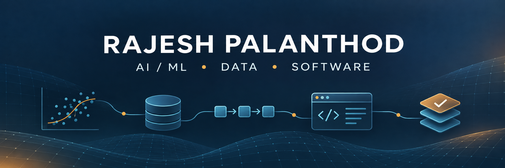

# Hi, I'm Rajesh Palanthod

AI/ML graduate building reliable software, intelligent applications, and data products.

I enjoy turning ambiguous problems into practical systems - from NLP applications and computer-vision models to ETL pipelines and full-stack tools. My recent work includes an AI legal assistant, a multi-user agency operations platform, and Databricks-based data integration pipelines.

## Tech stack

  

  
  
  
  
  

## Featured projects

| Project | What it demonstrates | Stack |
| --- | --- | --- |
| [NyayaLens AI](https://github.com/Rajesh-444/nyayalens-ai) | Explainable legal-document retrieval with cited evidence and transparent urgency signals | Python, NLP, TF-IDF |
| [WasteStream Lakehouse](https://github.com/Rajesh-444/waste-stream-lakehouse) | Contract-driven IoT ingestion with bronze, silver, gold, quarantine, and quality metrics | Python, PySpark, SQL, Parquet |
| [OpsPulse](https://github.com/Rajesh-444/ops-pulse) | Full-stack incident command center with a REST API, SQLite persistence, and responsive UI | Python, SQLite, JavaScript, HTML/CSS |
| [Resilient Task Engine](https://github.com/Rajesh-444/resilient-task-engine) | Durable background jobs with leases, idempotency, retry backoff, and dead-letter handling | Python, SQLite, unittest |
| [ATMS](https://atms-fwm.netlify.app) | Multi-user agency operations platform with authentication, role-based access, and realtime sync | JavaScript, PostgreSQL, Supabase, Netlify |

## Currently exploring

- Production-ready RAG systems with evaluation and grounded responses
- Data quality, observability, and incremental lakehouse pipelines
- Backend reliability patterns and clean software architecture

## Experience highlights

- Built an AI legal chatbot with Gemini Flash and NLP-based query processing during an AI internship at iLegal Advice.
- Developed Python and Spark SQL ETL pipelines on Databricks for multi-layer lakehouse workflows.
- Built and deployed ATMS, a cloud-backed agency operations platform with role-based access control.
- B.Tech in Artificial Intelligence & Machine Learning, Anurag University - CGPA 8.55/10.

## Let's connect

[LinkedIn](https://www.linkedin.com/in/rajesh-palanthod-b786a423b/) · [Email](mailto:rajeshpalanthod444@gmail.com) · [Portfolio project](https://atms-fwm.netlify.app)

